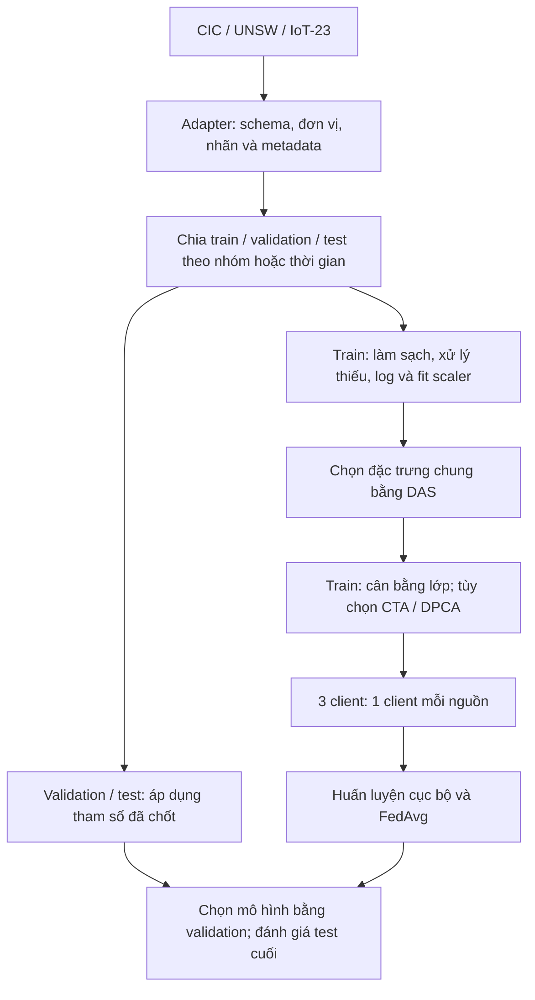

# Phân tích kết hợp CIC-DDoS2019, UNSW-NB15 và IoT-23

Ngày phân tích: **08/11/2026**, múi giờ Asia/Saigon. Mã nguồn tham chiếu: `27d72ce`.

Cập nhật yêu cầu triển khai: **3 client, mỗi client một dataset, và 3 lớp BENIGN / DOS_DDOS / OTHER_ATTACK**, đã được người dùng xác nhận. Xem [kế hoạch chi tiết 3 client và 3 lớp](ke_hoach_code_fl_3_client.md). Các mô tả 9 client trong bảng paper bên dưới chỉ là thông tin về bài báo; những phương án nhãn khác là phân tích nền, ngoài phạm vi v1.

Phạm vi: đọc paper PDF do giảng viên cung cấp, kiểm tra mã nguồn và dữ liệu cục bộ, đối chiếu tài liệu gốc của các dataset, đề xuất thiết kế tích hợp. Code pipeline ba dataset đã được triển khai theo kế hoạch (xem trạng thái trong [kế hoạch](ke_hoach_code_fl_3_client.md)); **chưa tải đủ dữ liệu và chưa huấn luyện lại mô hình**, nên các nhận định về đặc trưng tốt nhất cho ba nguồn bên dưới vẫn chưa được kiểm chứng.

## 1. Kết luận về phần còn thiếu

Dự án đã có tiền xử lý và lựa chọn đặc trưng cho **CIC-DDoS2019**. Phần chưa hoàn thiện là đưa **UNSW-NB15 và IoT-23 về cùng không gian đầu vào và hệ nhãn**, sau đó thực hiện lựa chọn đặc trưng, tiền xử lý và đánh giá trên cả ba nguồn.

Không thể giải quyết đầy đủ bằng cách ghép dòng ba bảng bằng `pd.concat()`. Cần thống nhất đồng thời:

1. Ý nghĩa của mỗi cột: cùng tên chưa bảo đảm cùng đại lượng.
2. Đơn vị đo và cách xác định flow, chiều truyền, thời lượng.
3. Nhãn mục tiêu: phát hiện mọi tấn công, phát hiện DoS/DDoS, hay phân loại họ tấn công.
4. Danh sách và thứ tự đặc trưng giống nhau ở tất cả client.
5. Cách chia train/validation/test và phạm vi được phép học tham số tiền xử lý.

Với dự án hiện tại, hướng khả thi là **viết adapter riêng cho từng nguồn, xác lập schema chung, giữ dữ liệu ở các client theo nguồn, rồi gộp trọng số bằng FedAvg**. Nếu muốn giữ nhiều đặc trưng chuyên biệt hoặc tái lập chặt chẽ hơn, cần cân nhắc trích xuất lại từ PCAP bằng cùng công cụ.

## 2. Paper mô tả đến đâu?

Nguồn chính: [paper PDF trong dự án](futureinternet-17-00088-v2%201.pdf), DOI [10.3390/fi17020088](https://doi.org/10.3390/fi17020088).

| Vị trí trong paper | Nội dung đã xác nhận | Ý nghĩa đối với dự án |
|---|---|---|
| Mục 3.1, trang 6 | Sử dụng CIC-DDoS2019, UNSW-NB15 và IoT23 | Cần xử lý đủ ba nguồn để thực hiện phần mở rộng này |
| Mục 3.2–3.6, trang 7–10 | AFN, CTA, MTB, DPCA, DAS, FDP, FRP | Đã có nhiều thành phần tương ứng trong code |
| Mục 3.6, Eq.13, trang 9–10 | Mỗi dataset được chia thành năm phần | Không nhất quán với bảng client ở phần thực nghiệm |
| Bảng 6, trang 22 | CL1–CL3: CIC; CL4–CL6: UNSW; CL7–CL9: IoT23 | Paper mô tả 9 client; triển khai của đồ án dùng 3 client theo yêu cầu giảng viên |
| Hình 11–12, trang 19 | Trình bày độ quan trọng đặc trưng theo từng dataset | Không thay thế được bảng ánh xạ schema hay danh sách đặc trưng tái lập được |
| Eq.22, trang 12 | Softmax để chọn lớp lưu lượng | Cách triển khai này phù hợp phân loại một nhãn nhiều lớp; thuật ngữ “multi-label” của paper cần được diễn giải thận trọng |
| Hình 14, trang 20, đã kiểm tra trực tiếp hình | Cả ba ma trận có Normal, SYN Flood, UDP Flood, HTTP GET, Slowloris | Paper chưa giải thích đầy đủ cách tạo năm nhãn này từ ba hệ nhãn gốc; v1 của đồ án dùng ba lớp đã chốt |

Trong các phần mô tả đã kiểm tra, paper **chưa cung cấp đủ quy tắc để tái lập việc thống nhất ba schema và ba hệ nhãn**. Hình 11–12 dùng những tên như Flow Duration, Packet Length Mean và các thống kê IAT trên nhiều nguồn, nhưng không giải thích đầy đủ cách suy ra chúng từ định dạng gốc của từng nguồn. Vì vậy, bảng mapping, quy tắc nhãn và xử lý cột thiếu dưới đây là **thiết kế đề xuất của dự án**, không phải chi tiết có thể khẳng định tác giả đã sử dụng.

## 3. Hiện trạng đã kiểm tra trên máy

### 3.1. Dữ liệu và pipeline

| Thành phần | Kết quả kiểm tra |
|---|---|
| Dữ liệu gốc | 17 file Parquet trong `data/raw/cicddos2019/`, mỗi file có 78 cột gồm nhãn |
| Nhóm `*-testing.parquet` | 306.201 dòng; code hiện dùng nhóm này làm nguồn train |
| Nhóm `*-training.parquet` | 125.170 dòng; code hiện dùng nhóm này làm nguồn test |
| UNSW-NB15 và IoT-23 | Chưa thấy file dữ liệu trong `data/raw/` |
| Đặc trưng ứng viên của bản `data_paper` | 65 |
| Đặc trưng DAS chọn | 25 |
| Đầu vào cuối | 36 = 25 đặc trưng chọn + 3 TEC + 6 NDS + 2 JAA |
| Nhãn train | 12 lớp, BENIGN ở vị trí 0 |
| Client hiện có | 3 client, chia giữ tỷ lệ nhãn gần giống nhau trong CIC |
| Dòng trước CTA/DPCA | 145.916, tổng ba client |
| Dòng sau CTA/DPCA | 175.247, tổng ba client |
| Test đã xử lý | 89.903 dòng, có giới hạn số mẫu mỗi nhãn |

Đây là số liệu của bản dữ liệu cục bộ; không đồng nhất nó với mọi artifact từng tạo trên Modal. Tên file `training/testing` và diễn giải ngày trong README là quy ước đang dùng của dự án. Bản Parquet hiện tại không có timestamp để xác minh ngày bắt gói độc lập chỉ từ các dòng dữ liệu.

Các vị trí quan trọng:

- [`prepare/paper_pipeline.py`](../prepare/paper_pipeline.py): chỉ có luồng đọc, nhãn và TEC dành cho CIC.
- [`fl_ddos/paper_prep.py`](../fl_ddos/paper_prep.py): đã có DAS và nhiều phép tiền xử lý có thể tái sử dụng sau khi tách rõ kiểu cột.
- [`fl_ddos/features.py`](../fl_ddos/features.py): bảng chuẩn hóa nhãn hiện là bảng CIC.
- [`fl_ddos/task.py`](../fl_ddos/task.py): nạp một schema chung, tách validation từ file client đã xử lý.
- [`modal_app.py`](../modal_app.py): chuẩn bị dữ liệu và điều phối thí nghiệm còn cố định luồng CIC/3 client.

### 3.2. Những đặc trưng đang được chọn thực sự

Trích từ `data_paper/features.json` và `prep_params.json`; điểm CRA được làm tròn:

| Thứ tự trong tập DAS đã chọn | Đặc trưng | CRA |
|---:|---|---:|
| 1 | `flow_bytes_s` | 0,075241 |
| 2 | `protocol` | 0,071570 |
| 3 | `flow_iat_std` | 0,065992 |
| 4 | `init_bwd_win_bytes` | 0,062347 |
| 5 | `avg_packet_size` | 0,058885 |
| 6 | `fwd_act_data_packets` | 0,058879 |
| 7 | `fwd_packet_length_min` | 0,056667 |
| 8 | `total_fwd_packets` | 0,051197 |
| 9 | `urg_flag_count` | 0,047943 |
| 10 | `packet_length_std` | 0,045193 |

Danh sách đầy đủ 65 ứng viên, điểm số và trạng thái được chọn được lưu trong [`cic_das_ranking_hien_tai.csv`](cic_das_ranking_hien_tai.csv).

Điểm CRA không phải phần trăm đóng góp của mô hình. Code tính trung bình bình phương tương quan với các biến chỉ báo lớp, rồi IDF loại các cột dư thừa. Vì vậy, `flow_duration` có điểm khá cao, khoảng 0,065156, nhưng vẫn không nằm trong tập cuối do điều kiện lọc phụ thuộc. Không được xem thứ tự CRA là danh sách cột bắt buộc giữ lại.

Các điểm này được tính trong pipeline CIC hiện tại, sau AFN và CTA/DPCA. **Chưa có cơ sở gọi chúng là 25 đặc trưng quan trọng nhất cho cả ba dataset.**

## 4. Thống nhất bài toán và nhãn trước khi ghép

UNSW-NB15 có nhiều họ tấn công, trong đó có `DoS`; không phải mọi mẫu tấn công UNSW đều là DDoS. Nguồn chính thức liệt kê chín nhóm tấn công và các bản dữ liệu có schema khác nhau giữa bộ đầy đủ và bộ train/test rút gọn. [Nguồn UNSW](https://research.unsw.edu.au/projects/unsw-nb15-dataset).

IoT-23 có nhãn DDoS, C&C, quét cổng, các nhãn hành vi/họ malware và nhãn kết hợp. Không nên suy từ tên malware rằng mọi flow đều là DDoS. [Nguồn IoT-23](https://www.stratosphereips.org/datasets-iot23).

Cần chọn một trong các thiết lập sau và ghi rõ trong báo cáo:

| Thiết lập | Mapping | Mục đích và giới hạn |
|---|---|---|
| Baseline tích hợp nhị phân | BENIGN / ATTACK, dùng nhãn độc hại gốc đã xác minh của từng nguồn | Dễ xác minh pipeline ba nguồn; đây là phát hiện xâm nhập tổng quát, không phải riêng DDoS |
| Nhị phân tập trung vào DoS/DDoS | Chỉ giữ benign và các nhãn DoS/DDoS đã xác nhận | Gần mục tiêu đề tài hơn; bỏ các tấn công khác khỏi thiết lập này, không đổi chúng thành benign |
| Ba lớp đề xuất | BENIGN / DOS_DDOS / OTHER_ATTACK | Giữ được tấn công khác và đo nhầm lẫn với DoS/DDoS; lớp giữa gộp hai khái niệm DoS và DDoS nên phải công bố rõ |
| Phân loại họ tấn công chi tiết | Thiết kế ontology, giữ nhãn nguồn và quy tắc gộp cụ thể | Phức tạp hơn; lớp chỉ xuất hiện ở một nguồn có thể khiến mô hình học dấu hiệu nguồn |

Theo quyết định hiện tại, v1 sử dụng BENIGN/DOS_DDOS/OTHER_ATTACK cho cả kiểm tra tích hợp và thí nghiệm chính. Phát hiện nhị phân BENIGN/ATTACK được tính thêm từ xác suất đầu ra của cùng mô hình, không cần huấn luyện một bộ phân loại nhị phân riêng. Nhãn DoS của UNSW không tự chứng minh được thuộc DDoS; tên lớp gộp DOS_DDOS và báo cáo phải giữ rõ giới hạn này.

Metadata nên giữ `dataset_id`, `capture_id`, `original_label`, nhãn chuẩn, timestamp nếu có, và ID dòng để truy vết. Không đưa `dataset_id`, tên file hay nhãn gốc vào vector đầu vào. Nhãn chưa biết phải được báo lỗi hoặc đưa vào vùng kiểm tra, không mặc định gán tấn công/benign.

Một điểm cần kiểm tra riêng: `_LABEL_MAP` đang đổi `Portmap` thành `PortScan`. Trang CIC chính thức cũng dùng cả hai tên trong phần mô tả. Khi tích hợp với nhãn quét cổng của UNSW/IoT-23, nên giữ nhãn nguồn `Portmap` và xác minh ý nghĩa trước khi gộp; không xem phép đổi tên hiện tại là bằng chứng hai hành vi giống nhau. [Nguồn CIC](https://www.unb.ca/cic/datasets/ddos-2019.html).

## 5. Không gian đặc trưng chung

### 5.1. Mapping ứng viên từ dữ liệu dạng bảng

Bảng này là **mapping cần kiểm chứng trên đúng phiên bản tải về**, chưa phải schema ba nguồn đã được xác nhận bằng thực nghiệm:

| Trường chuẩn | CIC hiện tại | UNSW bản train/test thường dùng | IoT-23/Zeek | Điều kiện |
|---|---|---|---|---|
| `duration_s` | `Flow Duration / 1e6` | `dur` | `duration` | Đưa về giây; vẫn cần ghi nhận khác biệt quy tắc đóng flow |
| `protocol` | `Protocol` | `proto` | `proto` | Chuẩn hóa về nhóm TCP/UDP/ICMP/OTHER và mã hóa phân loại |
| `fwd_packets` | `Total Fwd Packets` | `spkts` | `orig_pkts` | Kiểm tra cùng quy ước chiều và cách đếm |
| `bwd_packets` | `Total Backward Packets` | `dpkts` | `resp_pkts` | Như trên |
| `fwd_bytes` | `Fwd Packets Length Total` | `sbytes` | `orig_bytes` hoặc `orig_ip_bytes`, tùy định nghĩa đã xác minh | **Chưa đủ điều kiện coi là tương đương** |
| `bwd_bytes` | `Bwd Packets Length Total` | `dbytes` | `resp_bytes` hoặc `resp_ip_bytes`, tùy định nghĩa đã xác minh | **Chưa đủ điều kiện coi là tương đương** |

Đơn vị microsecond của `Flow Duration` trong dữ liệu cục bộ được kiểm tra chéo bằng `(Total Fwd Packets + Total Backward Packets) / Flow Duration × 1e6`: phân vị 1%, 50%, 99% của tỷ lệ so với `Flow Packets/s` đều xấp xỉ 1 trên các dòng có mẫu số hợp lệ. Mã nguồn CICFlowMeter cũng dùng hệ số `1e6` khi tính tốc độ theo giây. [Mã nguồn CICFlowMeter](https://github.com/ahlashkari/CICFlowMeter/blob/master/src/main/java/cic/cs/unb/ca/jnetpcap/BasicFlow.java).

Hai cột byte cần kiểm tra kỹ: Zeek phân biệt byte payload và byte ở mức IP; duration của Zeek cũng có quy tắc riêng khi kết thúc TCP. Đổi tên cột không xóa được khác biệt đó. Đối chiếu phiên bản extractor và kiểm tra trên mẫu PCAP trước khi đưa byte vào schema chính. [Định nghĩa Conn::Info](https://docs.zeek.org/en/lts/scripts/base/protocols/conn/main.zeek.html).

Điểm khởi đầu bảo thủ là `duration_s`, hai số đếm packet và protocol. Thêm hai số đếm byte khi đã xác minh tương thích. Các trường này vẫn có sai khác giữa extractor; nếu cần khả năng so sánh chặt, dùng phương án PCAP ở mục 5.3.

### 5.2. Đặc trưng dẫn xuất và trường cần loại

Từ các trường đã được chấp nhận có thể tạo:

- `total_packets = fwd_packets + bwd_packets`.
- `packet_rate = total_packets / duration_s`, kèm quy tắc riêng cho duration bằng 0 hoặc thiếu.
- `bwd_packet_fraction = bwd_packets / total_packets` khi tổng packet dương.
- Nếu byte tương thích: tổng byte, byte rate, tỷ lệ byte hai chiều, byte trung bình trên packet theo đúng tầng đã chọn.
- Cờ chất lượng như `duration_zero`; chỉ giữ cờ thiếu dữ liệu nếu đánh giá cho thấy nó không chủ yếu nhận diện nguồn.

Không cần giữ mọi cột dẫn xuất: chúng có thể phụ thuộc mạnh vào cột gốc và sẽ qua DAS/validation. Với mẫu số bằng 0, không để sinh vô cực rồi xóa hàng loạt một cách im lặng; cần quy tắc thiếu dữ liệu, giới hạn tốc độ học từ train nếu sử dụng, và thống kê ảnh hưởng theo nguồn/lớp.

Không thể khôi phục chính xác độ lệch chuẩn kích thước packet hoặc IAT chỉ từ tổng packet, tổng byte và duration. `bytes/packets` cũng không mặc nhiên tương đương `Packet Length Mean` của một công cụ khác.

Các trường chưa có ở đủ nguồn như IAT, TCP window, flag count, `service`, `conn_state`, `history` không thuộc schema chung ban đầu. Bản CIC cục bộ còn không có cột cổng; một số bản UNSW rút gọn cũng không giữ cổng/IP. Không thiết kế schema dựa trên cột chỉ có trong một phiên bản khác.

Tránh lấy hợp mọi cột rồi điền 0 cho cột thiếu toàn bộ ở một nguồn. Mẫu thiếu theo nguồn dễ trở thành dấu hiệu nhận diện dataset. Điền median chỉ phù hợp cho giá trị thiếu trong cột đã thống nhất ý nghĩa; nó không tạo ra phép đo vốn chưa tồn tại.

### 5.3. Phương án dùng PCAP

Nếu cần giữ IAT, thống kê packet và đặc trưng TCP trên cả ba nguồn, trích xuất lại PCAP bằng cùng công cụ, phiên bản và cấu hình timeout. Sau đó ánh xạ nhãn gốc bằng thời gian, endpoint, protocol và quy tắc khớp đã kiểm tra.

Đây là phương án đồng nhất phép đo tốt hơn, nhưng tốn lưu trữ/xử lý và **không được giả định mỗi flow mới khớp một-một với flow được gán nhãn cũ**. Phải báo cáo tỷ lệ khớp nhãn, mẫu không khớp và mẫu có nhãn mâu thuẫn. Chọn CSV/Parquet hay PCAP là đánh đổi cần công bố, không phải hai cách tương đương về độ tin cậy phép đo.

## 6. Thứ tự tiền xử lý đề xuất

Sơ đồ biểu diễn phụ thuộc xử lý. Việc chia client vật lý có thể diễn ra ngay sau chia tập; mọi bước fit sau đó thực hiện cục bộ và gộp thống kê train theo thiết kế FL.

1. **Adapter và kiểm tra schema:** đọc đúng định dạng, giữ metadata ngoài đặc trưng, chuẩn hóa đơn vị và nhãn bằng quy tắc cố định. Với IoT-23, kiểm tra `#fields`, separator và định dạng nhãn của file thực tế; ký hiệu `-` không mặc nhiên có nghĩa là 0.
2. **Chia tập trước bước fit/sinh mẫu:** CIC giữ nguồn test khác đợt theo thiết lập hiện tại; validation lấy từ nguồn train trước xử lý học tham số. UNSW giữ test chính thức làm mốc; kiểm tra trùng/nhóm giữa các tập. IoT-23 ưu tiên giữ nguyên capture/scenario ở một phía của phép chia. Nếu nhóm và phân phối nhãn không cho phép phân tầng hoàn hảo, công bố coverage thay vì chuyển flow cùng nhóm qua nhiều tập.
3. **Kiểm tra chất lượng:** kiểu dữ liệu, giá trị âm/sentinel, NaN/Inf, hàng trùng và nhãn mâu thuẫn. Ghi số dòng bị loại theo nguồn và lớp; không `dropna()` trên hợp toàn bộ schema. Trùng/gần trùng giữa tập phải được kiểm tra, nhưng không mặc định gộp mọi flow có cùng vector vì chúng có thể là các sự kiện khác nhau.
4. **Biến đổi số và mã hóa category:** log1p cho đại lượng không âm bị lệch; sentinel như `-1` phải có ý nghĩa rõ trước khi biến đổi. Protocol dùng one-hot hoặc nhóm cố định; không log, z-score như đại lượng liên tục rồi nội suy. Dùng scaler chung fit trên train, hoặc AFN theo protocol quan sát được; không chọn nhóm AFN bằng nhãn thật của validation/test.
5. **Chọn đặc trưng:** DAS trên train thật để có mốc dễ diễn giải; nếu muốn bám thứ tự paper, chạy thêm đối chứng DAS sau CTA/DPCA. Hai thứ tự là hai thiết kế khác nhau và phải ghi rõ.
6. **Cân bằng train cục bộ:** bắt đầu với class weight và giới hạn lấy mẫu theo nguồn/lớp. Nếu thêm CTA/DPCA, chỉ nội suy cột liên tục trong cùng client, lớp và ngữ cảnh thích hợp; cột phân loại phải được giữ hợp lệ. Không để dữ liệu tổng hợp trở thành phần lớn bằng chứng cho lớp cực hiếm.
7. **Đặc trưng dẫn xuất:** chỉ dùng phép có nghĩa trên schema đã chốt. Nếu tái sử dụng NDS/JAA, chỉ ghép các biến liên tục phù hợp và đánh giá lợi ích. TEC/MTB cần timestamp đáng tin và chuỗi quan sát hợp lệ; không dùng thứ tự dòng của file đã shuffle để tuyên bố quan hệ thời gian.
8. **Lưu và áp dụng:** imputer, scaler/AFN, category mapping, schema, DAS, DRA/LIS nếu dùng phải được lưu đủ để tái hiện dự đoán. Validation/test chỉ transform, không resample, không fit lại. Các bước fit này cũng phải nằm bên trong từng fold nếu dùng cross-validation.

Việc chia tập trước khi fit và chỉ resample train phù hợp hướng dẫn chính thức về tránh rò rỉ dữ liệu của [scikit-learn](https://scikit-learn.org/stable/common_pitfalls.html) và [imbalanced-learn](https://imbalanced-learn.org/stable/common_pitfalls.html).

## 7. Lựa chọn đặc trưng trên ba nguồn

### 7.1. DAS hiện tại làm gì?

Với đặc trưng liên tục `x_j` và biến chỉ báo lớp `1[y=c]`, CRA tính:

`R(j,c) = Cov(x_j, 1[y=c])² / (Var(x_j) × Var(1[y=c]))`.

Code lấy trung bình qua các lớp có phương sai nhãn dương. IDF xét theo thứ tự CRA giảm dần, giữ một cột nếu độ lớn tương quan với mọi cột đã giữ nhỏ hơn ngưỡng. Thiết lập hiện tại là relevance > 0,001, |correlation| < 0,9, tối đa 25 cột.

Các cột hằng và lớp không có mặt trong một nguồn phải được xử lý rõ; không chia cho phương sai bằng 0. Với protocol one-hot, xử lý các dummy như một nhóm khi chọn/đánh giá và không xem mã category 6/17 là đại lượng có khoảng cách vật lý.

### 7.2. Thích nghi với ba dataset

Chỉ tính điểm trên tập ghép có thể ưu tiên nguồn có nhiều flow hoặc cột nhận diện nguồn. Đề xuất bổ sung bảng điểm theo nguồn:

`R_shared(j) = (R_CIC(j) + R_UNSW(j) + R_IoT(j)) / 3`,

trong đó mỗi `R_dataset(j)` được tính trên train của nguồn đó với hệ nhãn đã chốt và chỉ các lớp có đủ biến thiên. Nếu không đủ dữ liệu để tính, phải đánh dấu và công bố; không âm thầm coi điểm không xác định là 0. Công thức trung bình đều này là **đề xuất mở rộng DAS**, không phải công thức được xác nhận trong paper.

Với nhãn gộp mà một nguồn không có lớp nào đó, cần thêm kiểm tra theo từng lớp và coverage; một điểm trung bình duy nhất có thể che việc đặc trưng hữu ích cho lớp hiếm.

Quy trình lựa chọn:

1. Loại cột không tương thích ngữ nghĩa, cột hằng, cột định danh và cột thiếu không thể sửa.
2. Tính CRA và độ dư thừa trên train; so sánh điểm pooled với điểm theo nguồn.
3. Thử một số kích thước tập phù hợp số ứng viên thực tế; không bắt buộc đủ 25 nếu schema chung nhỏ.
4. Chọn số cột/ngưỡng bằng F1-macro trên validation của từng nguồn, xét cả nguồn kém nhất và chi phí huấn luyện.
5. Kiểm chứng bằng permutation importance trên validation, xáo trộn bên trong từng nguồn; đánh giá theo nhóm với protocol và các cột dẫn xuất liên quan. Đây là kiểm chứng bổ sung, không dùng test để chọn lại cột.
6. Lặp qua nhiều seed hoặc chia nhóm để xem độ ổn định của danh sách. Chốt schema một lần cho toàn federation.

CRA tuyến tính có thể bỏ qua quan hệ phi tuyến. Có thể đối chứng mutual information hoặc permutation importance với một mô hình cây, nhưng không cần thay DAS trước khi có baseline ba nguồn hợp lệ.

Không chọn 25 cột riêng cho từng dataset rồi gộp trọng số mô hình trực tiếp: cột ở vị trí thứ `j` phải có cùng ý nghĩa trên mọi client. Nếu cần giữ schema riêng, phải thiết kế encoder riêng và latent space chung; đó là thay đổi kiến trúc và thuật toán gộp lớn hơn phạm vi tích hợp hiện tại.

## 8. Các vấn đề hiện có cần sửa trước khi mở rộng

| Vấn đề | Bằng chứng | Hướng xử lý |
|---|---|---|
| Validation được tách quá muộn | `load_local()` lấy 10% từ file đã qua AFN/CTA/DPCA/DAS/DRA/LIS | Tạo validation từ mẫu gốc trước các bước học tham số và sinh mẫu |
| Validation trùng train | Với seed 0: client 1 có 776/5.846, client 2 có 762/5.845, client 3 có 756/5.834 mẫu validation có vector đặc trưng trùng train | Chia theo nhóm trước; đo cả trùng và phụ thuộc do sinh mẫu |
| Nội suy protocol | Đảo DRA/LIS trên client và so với các mã protocol đã log cho thấy 874, 929, 845 dòng lần lượt không khớp mã hợp lệ, tolerance `1e-5` | Tách categorical khỏi CTA/WIS; dùng mapping protocol gốc |
| Protocol đã log trước khi làm khóa AFN | `load_day()` áp `slog1p` cho tất cả cột; `afn_groups()` sau đó ép protocol về int | Giữ bản protocol category nguyên để grouping; tránh phụ thuộc ngầm vào biến đổi số |
| Sinh quá nhiều từ lớp cực hiếm | WebDDoS có 17 mẫu gốc mỗi client, sau DPCA khoảng 4.862–4.863 mẫu | Giới hạn mức sinh, dùng weight, báo cáo số mẫu thật và coverage theo nhóm |
| Chưa đủ artifact suy luận | `prep_params.json` lưu DRA/LIS nhưng chưa lưu đầy đủ mean/std AFN để nạp lại pipeline từ đầu | Lưu toàn bộ fitted preprocessing và version schema |
| Test dùng mỗi vòng, lưu vòng cuối | `server_app.py` đánh giá global test theo round, lưu model cuối | Dùng validation chọn checkpoint/ngưỡng, test đánh giá sau khi chốt |
| Khối lượng nguồn lệch nhau | Ba dataset có quy mô và cơ chế thu thập khác nhau | Kiểm soát sampling train; báo cáo kết quả từng nguồn, không chỉ chỉ số pooled |

Phép đo trùng validation ở đây dùng hash của đúng 36 cột đầu vào, bỏ index và nhãn, theo phép chia `df.sample(frac=0.1, random_state=0)` hiện tại. Nó kiểm tra trùng vector, không chứng minh cùng ID flow và không đo gần trùng. Các phát hiện này **không tự chứng minh test khác ngày bị rò rỉ nhãn**.

Không nên suy từ các dòng tổng hợp có protocol hợp lệ rằng mọi thuộc tính khác cũng hợp lệ: nội suy số đếm, cờ và tỷ lệ còn cần được xem xét theo ý nghĩa đo lường.

Kết quả hiện có của ResVGG-SwinNet/FedAvg ở `main` đạt F1 nhị phân trung bình khoảng 0,7015; `random` khoảng 0,9991. Đây là hai điều kiện đánh giá khác nhau, không phải bằng chứng rằng ghép thêm dữ liệu sẽ đạt 99%. Xem [báo cáo main](../results_modal/full/main/summary.md), [random](../results_modal/full/random/summary.md) và [ghi chú huấn luyện hiện có](2026-11-08_ghi_chu_huan_luyen.md).

## 9. Thiết lập FL và kế hoạch triển khai cụ thể

### 9.1. Thiết lập đề xuất

Theo yêu cầu triển khai đã chốt với người dùng:

- Client 1 (partition-id 0): dữ liệu train CIC.
- Client 2 (partition-id 1): dữ liệu train UNSW.
- Client 3 (partition-id 2): dữ liệu train IoT-23.
- Cả ba client sử dụng cùng danh sách đặc trưng, cùng category mapping và cùng thứ tự lớp.
- Các mẫu cùng capture/session hoặc nhóm liên quan không đi qua nhiều phía train/validation/test. Không bắt buộc chia đều số dòng nếu việc đó phá cấu trúc nhóm.
- Thống kê imputer/scaler/DAS chỉ tính từ train. Các hàm thống kê hiện có có thể làm nền để gộp ở server; vẫn cần xác định rõ cách cân bằng ảnh hưởng giữa nguồn.

FedAvg hiện gộp theo số mẫu học. Khi resampling rất khác nhau giữa nguồn, số mẫu tổng hợp có thể làm thay đổi trọng số client mạnh. Cần lưu cả `n_real_train` và `n_effective_train`, công bố quy tắc gộp; thử cân bằng nguồn là một đối chứng riêng, không gọi nó mặc nhiên là FedAvg chuẩn hiện tại.

Mô phỏng tập trung việc đọc file có thể dùng để nghiên cứu, nhưng cần phân biệt trong báo cáo với triển khai FL nơi raw data thực sự nằm riêng.

### 9.2. Thứ tự công việc và đầu ra

| Ưu tiên | Công việc | Đầu ra cần có |
|---|---|---|
| 1 | Chốt bài toán, phiên bản hai dataset mới và nguồn tải | Manifest file, checksum, schema gốc, quy tắc nhãn |
| 2 | Adapter CIC/UNSW/IoT và kiểm tra tính tương thích | Bảng chung có metadata, báo cáo cột thiếu/đơn vị/nhãn chưa biết |
| 3 | Chia train/validation/test độc lập | Split manifest, phân phối nhãn và kiểm tra overlap theo nhóm |
| 4 | Pipeline train-only và DAS dùng chung | Preprocessor lưu đủ tham số, feature ranking theo nguồn, schema cuối |
| 5 | Xuất dữ liệu cho 3 client và validation/test riêng | Mỗi client đúng một nguồn; file cùng schema, phân phối mẫu thật/tổng hợp, dataset manifest |
| 6 | Sửa loader, checkpoint và metric theo nguồn | Không tách validation từ dữ liệu đã augment; chọn model bằng validation |
| 7 | Chạy baseline và thí nghiệm FL | Kết quả từng nguồn, từng lớp, nhiều seed, chi phí và đối chứng |

Các thay đổi mã nguồn dự kiến:

| Vị trí | Thay đổi cần thiết |
|---|---|
| `prepare/` | Adapter riêng, manifest và pipeline đa nguồn; giữ pipeline CIC làm mốc đối chứng |
| `fl_ddos/features.py` | Chuẩn hóa schema/protocol/nhãn theo nguồn và version |
| `fl_ddos/paper_prep.py` | Tách cột liên tục/category; DAS có báo cáo theo nguồn; xử lý trường hợp thiếu lớp/cột |
| `fl_ddos/task.py` | Nạp validation đã chia sẵn và metadata phục vụ metric theo nguồn |
| `fl_ddos/server_app.py` | Chọn checkpoint bằng validation; đánh giá test cuối và báo cáo từng nguồn |
| `analysis/plots.py` | Biểu đồ/chỉ số theo dataset, lớp và so sánh schema/feature set |
| `modal_app.py`, cấu hình và scripts | Chuẩn bị ba nguồn; truyền đúng số client; tránh hardcode 3 |

Không cần thay ngay kiến trúc ResVGG-SwinNet chỉ để đổi số đặc trưng: `make_model()` đã lấy kích thước đầu vào từ metadata. Tuy nhiên, schema chung nhỏ có thể phù hợp mô hình đơn giản hơn; cần so với MLP, mô hình cây tập trung và ResNet-only trước khi kết luận lợi ích của kiến trúc lớn.

### 9.3. Thí nghiệm xác nhận giá trị của việc kết hợp

Giữ cùng feature schema, cách chia dữ liệu và quy tắc chọn mô hình để so sánh:

1. Mỗi dataset train riêng, đánh giá trên test của nó.
2. Ghép train ba nguồn để huấn luyện tập trung làm baseline nghiên cứu.
3. FL 3 client, một client mỗi nguồn, dùng cùng ngân sách đã công bố.
4. Không DAS so với DAS; cân bằng bằng weight so với thêm CTA/DPCA.
5. Bỏ lần lượt một nguồn khi train và đánh giá nguồn còn lại, nếu coverage nhãn cho phép. Đây là đánh giá tổng quát sang miền mới, khác với test đã có cả ba nguồn trong train.

Metric cần có: F1-macro, precision/recall từng lớp, FAR trên benign, ma trận nhầm lẫn và PR-AUC phù hợp mục tiêu. Báo cáo riêng CIC/UNSW/IoT, trung bình đều giữa nguồn và kết quả pooled kèm số mẫu. Nếu đánh giá DDoS thuần túy, tách rõ phần có nhãn DDoS đã xác minh khỏi lớp DoS gộp. Dùng ít nhất cùng bộ seed cho các so sánh trọng tâm.

Để đánh giá sát phân phối ban đầu, test chính nên giữ phân phối nguồn/lớp hoặc phải công bố rõ việc giới hạn mẫu. Test hiện tại giới hạn BENIGN và SYN ở 30.000 dòng nên các metric chịu ảnh hưởng của cách lấy mẫu; không gọi nó là toàn bộ phân phối tự nhiên.

## 10. Điều kiện để tuyên bố hoàn thành

- Có đủ dữ liệu ba nguồn và schema/label mapping đã được kiểm tra trên file thực tế.
- Mọi client có cùng đặc trưng, thứ tự cột và thứ tự lớp; không có NaN/Inf trong tensor đầu vào.
- Có split manifest độc lập; mọi fitted preprocessing và resampling chỉ dùng train.
- Có xếp hạng đặc trưng theo nguồn và tập cuối được chọn bằng validation, không dựa vào test.
- Protocol/category luôn hợp lệ; không tạo dữ liệu tổng hợp cho validation/test.
- Có preprocessor lưu đủ tham số và có thể tái tạo đầu vào dự đoán từ dữ liệu chưa xử lý.
- Có kết quả theo từng nguồn và baseline để kiểm tra việc kết hợp cải thiện hay làm giảm hiệu năng.

**Hiện tại mới có thể xác nhận phân tích và lựa chọn đặc trưng của CIC. Danh sách đặc trưng tốt nhất cho cả ba bộ chỉ được xác lập sau khi có hai nguồn còn thiếu và chạy quy trình đánh giá nêu trên.**
