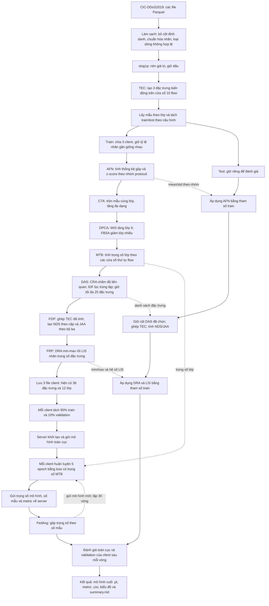

# Pipeline hiện tại: từ dữ liệu CIC-DDoS2019 đến kết quả phát hiện DDoS

Tài liệu mô tả pipeline `paper` theo mã nguồn hiện tại, tập trung vào cấu hình `main`. Tên đầy đủ các phương pháp được đối chiếu với PDF `futureinternet-17-00088-v2 1.pdf`, mục 3.2–3.7 và phần Abbreviations. Cách thực hiện cụ thể bên dưới lấy theo code, vì dự án có điều chỉnh so với bài báo.

Mạch ghi nhớ: **Đọc và làm sạch → nén giá trị → thêm thông tin biến động → chia dữ liệu → chuẩn hóa → làm đa dạng và cân bằng mẫu → chọn rồi tạo đặc trưng → điều chỉnh thang đo → học liên kết → đánh giá.**

## 1. Sơ đồ từ đầu đến cuối



Sơ đồ gộp các file ở phần đọc để dễ nhìn. Trong `main`, code biết ngày nào dùng cho train/test từ mẫu tên file rồi làm sạch, tính TEC và lấy mẫu riêng từng ngày. Với `random`, code chia train/test sau khi đã tính TEC và lấy mẫu trong ngày đầu.

Các phép biến đổi test được thực hiện và lưu ở giai đoạn chuẩn bị dữ liệu; khi huấn luyện, server đọc tập test đã chuẩn bị.

## 2. Dữ liệu đầu vào và cách chia

Một **flow** là một bản ghi mô tả một luồng giao tiếp mạng, có các đặc trưng như số gói, số byte, khoảng cách giữa các gói và giao thức. Mỗi dòng dữ liệu là một mẫu; mỗi cột đo lường là một đặc trưng.

**DDoS — Distributed Denial of Service:** tấn công từ chối dịch vụ phân tán. **BENIGN** là nhãn lưu lượng bình thường.

| Cấu hình | Train/test | AFN | Mục đích |
|---|---|---|---|
| `main` | Train ngày 12/01/2019, test ngày 11/03/2019 | Nhóm theo protocol | Đánh giá trên dữ liệu ngày khác |
| `random` | Chia theo nhãn khoảng 80/20 trong ngày 12/01/2019 | Nhóm theo protocol | Đánh giá khi train/test cùng ngày |
| `leak` | Chia theo ngày như `main` | Nhóm theo nhãn BENIGN/attack, kể cả test | Minh họa rò rỉ nhãn |

Bản Parquet đang dùng có tên `*-testing.parquet` tương ứng ngày 12/01 và `*-training.parquet` tương ứng ngày 11/03; code đã chọn glob theo chiều này.

Trước khi chia client, train giới hạn tối đa 30.000 mẫu cho mỗi lớp tấn công và giữ toàn bộ BENIGN hợp lệ; test giới hạn tối đa 30.000 mẫu mỗi nhãn. Các giới hạn này diễn ra sau TEC, trước chuỗi AFN–FRP. Vì vậy, câu “không tăng/giảm mẫu test” ở phần sau chỉ nói đến các bước augmentation và balancing.

## 3. Làm sạch, slog1p và TEC

**Làm sạch:** loại IP, Flow ID, Timestamp và các cột trong danh sách `DROP`; thống nhất tên nhãn; chuyển đặc trưng sang số; loại các dòng có giá trị không hợp lệ. Code hiện tại không tự điền giá trị thiếu.

**slog1p — signed log-one-plus:** tên hàm chỉ phép biến đổi log có giữ dấu:

```text
slog1p(x) = sign(x) × ln(1 + |x|)
```

Mục đích: nén khoảng giá trị của những đặc trưng lệch mạnh. Ví dụ `999` thành khoảng `6,91`, `0` vẫn bằng `0`, `-1` thành khoảng `-0,69`. Đây là bước bổ sung trong code; tên hàm không phải tên một phương pháp viết tắt trong bài báo.

**TEC — Temporal Evolution Capturer:** ghi nhận biến động của đặc trưng theo cửa sổ các flow. Code dùng cửa sổ 10 dòng trong cùng file cho ba cột `flow_packets_s`, `flow_bytes_s`, `flow_iat_mean`, sau khi biến đổi log. Công thức dùng chênh lệch giữa giá trị hiện tại và giá trị cách 9 dòng, chia cho 9; phần đầu file dùng giá trị đầu tiên thay cho lịch sử còn thiếu.

Đầu ra: 3 cột `tec_*`. TEC thuộc **FDP** trong bài báo nhưng được tính sớm trong code để sử dụng thứ tự dòng trước khi lấy mẫu và sinh thêm dữ liệu. Vì bản dữ liệu không có Timestamp, đây là biến động theo **thứ tự dòng**, không phải tốc độ theo giây thực tế.

## 4. Chia client và AFN — chuẩn hóa đầu vào

Train được chia thành 3 client bằng cách chia riêng từng lớp. Các client có phân phối nhãn gần giống nhau; đây không phải cách chia mỗi client chỉ giữ một loại tấn công.

**AFN — Adaptive Feature Normalization:** chuẩn hóa đặc trưng thích nghi theo nhóm.

Trong `main`, nhóm được xác định bằng protocol. Mỗi đặc trưng số có một mean/std riêng cho mỗi nhóm:

```text
z[j] = (x[j] - mean[group, j]) / (std[group, j] + epsilon)
```

Ví dụ: `flow_bytes_s` của flow TCP được chuẩn hóa bằng thống kê TCP; flow UDP dùng thống kê UDP. Protocol đóng vai trò khóa nhóm, không cần biết flow là BENIGN hay tấn công.

Các client cung cấp số mẫu, tổng và tổng bình phương; hàm gộp tính mean/std chung cho từng nhóm. Test dùng lại các tham số này; nhóm chưa gặp trong train dùng thống kê train toàn cục dự phòng.

**Chi tiết triển khai hiện tại:** cột protocol đầu vào được kỳ vọng là mã số. Code đang áp dụng `slog1p` lên cả protocol rồi ép sang số nguyên để lấy nhóm; AFN loại protocol khỏi các cột z-score. Việc giữ nguyên mã protocol làm khóa nhóm sẽ rõ nghĩa hơn, nhưng tài liệu này mô tả code đang có và không sửa cách xử lý đó.

## 5. CTA, DPCA và MTB — chuẩn bị việc học với dữ liệu mất cân bằng

Ba bước này chạy riêng trên dữ liệu từng client.

### CTA — Contextual Traffic Augmentation

**Tăng cường lưu lượng theo ngữ cảnh.** Code trộn hai vector đặc trưng cùng lớp, lân cận theo thứ tự thời gian, để tạo mẫu nhân tạo:

```text
x_new = beta × x_a + (1 - beta) × x_b
```

Mục đích: tăng sự đa dạng trong lớp. Tỷ lệ yêu cầu mặc định là 20%; số mẫu thực tế có thể thấp hơn vì các cặp khác lớp bị bỏ qua. Nhãn của mẫu mới vẫn là nhãn chung của hai mẫu gốc.

### DPCA — Dynamic Proportional Class Adjustment

**Điều chỉnh số mẫu theo tỷ lệ lớp.** Sau CTA, tính số mẫu trung bình của các lớp trong client, rồi đưa số mẫu mỗi lớp về gần mức đó bằng hai nhánh:

- **WIS — Weighted Instance Synthesis:** tạo mẫu có trọng số bằng cách nội suy giữa các mẫu cùng lớp cho lớp ít mẫu. Trong code, mẫu ghép được chọn gần nhất trong 5 ứng viên lấy ngẫu nhiên.
- **FBSA — Frequency-depending Sampling Adjustment:** giảm số mẫu lớp nhiều bằng xác suất giữ mẫu theo tần suất lớp. Giữ ngẫu nhiên nên số mẫu sau bước này không nhất thiết bằng đúng mức trung bình.

Ví dụ: nếu ba lớp có 100, 300 và 800 mẫu thì mức trung bình là 400. Hai lớp đầu được tăng mẫu; lớp cuối được giảm về xấp xỉ 400.

### MTB — Multi-scale Temporal Balancing

**Cân bằng theo các khung thời gian.** Trong code, mẫu được sắp theo thứ tự flow rồi chia thành 10 cửa sổ; tần suất lớp trong các cửa sổ được dùng để tính trọng số lớp.

Code dùng nghịch đảo của trọng số tần suất, chuẩn hóa và giới hạn trong `[0,1; 10]`. Đầu ra được lưu thành `mtb_weights.json` và dùng trong **weighted cross-entropy loss** khi huấn luyện.

Phân biệt vai trò:

- CTA tạo thêm biến thể mẫu.
- DPCA thay đổi số lượng mẫu giữa các lớp.
- MTB thay đổi mức phạt khi mô hình dự đoán sai một lớp; bước này không trực tiếp tăng hay giảm mẫu.

## 6. DAS — chọn đặc trưng đáng giữ

**DAS — Dual Adaptive Selector:** bộ chọn thích nghi kép, gồm hai thành phần:

| Thành phần | Tên đầy đủ | Việc thực hiện trong code |
|---|---|---|
| CRA | Conditional Relevance Assessor | Chấm điểm mỗi đặc trưng bằng bình phương tương quan với nhãn one-hot của từng lớp, rồi lấy trung bình |
| IDF | Iterative Dependency Filter | Duyệt theo điểm từ cao xuống thấp, bỏ đặc trưng có tương quan tuyệt đối từ 0,9 trở lên với cột đã chọn |

Mục đích: giữ các đặc trưng liên quan đến nhãn và giảm trùng lặp thông tin. Ví dụ hai cột đo gần như cùng một đại lượng không nhất thiết phải giữ cả hai.

Các thống kê được gộp từ client. Code giữ tối đa 25 đặc trưng ứng viên vượt ngưỡng relevance `0.001`. Ba cột TEC được giữ riêng và ghép lại sau bước chọn. Test chỉ lấy các cột đã chọn từ train.

## 7. FDP — tạo thêm thông tin từ các đặc trưng đã chọn

**FDP — Feature Derivation Process:** quá trình tạo đặc trưng dẫn xuất. Trong bài báo, nhóm này gồm **NDS + TEC + JAA**. Trong code, TEC đã tính từ đầu; tại đây chỉ ghép TEC và tạo NDS/JAA.

| Thành phần | Tên đầy đủ | Cách tính và ý nghĩa |
|---|---|---|
| NDS | Nonlinear Dependency Synthesis | `ln(1 + abs(a × b))`: tạo đặc trưng tương tác phi tuyến giữa hai cột |
| TEC | Temporal Evolution Capturer | Ghi nhận biến động theo cửa sổ flow; đã tính ở phần đầu |
| JAA | Joint Attribute Aggregator | `sqrt((a² + b² + c²) / 3)`: tổng hợp ba cột thành một giá trị RMS |

**RMS — Root Mean Square:** căn của trung bình bình phương.

Với dữ liệu `data_paper/features.json` hiện có:

```text
25 cột do DAS chọn
+ 3 cột TEC
+ 6 cột NDS (mọi cặp trong 4 cột được chọn đầu tiên)
+ 2 cột JAA (hai bộ ba cột được chọn đầu tiên)
= 36 đặc trưng đầu vào mô hình
```

Đây là **tạo thêm cột**, khác với CTA/WIS là **tạo thêm dòng mẫu**.

## 8. FRP — điều chỉnh lại thang đo và tác động của từng cột

**FRP — Feature Recalibration Process:** quá trình hiệu chỉnh lại đặc trưng, gồm hai bước nối tiếp:

1. **DRA — Dynamic Range Adjustment:** dùng min/max gộp từ train để đưa mỗi cột train về khoảng `[0,1]`.
2. **LIS — Local Impact Scaling:** tính hệ số cho từng đặc trưng dựa trên quan hệ với nhãn BENIGN/attack trong train, rồi nhân đặc trưng với hệ số đó.

```text
x_scaled = (x - min_train) / (max_train - min_train + epsilon)
x_final[j] = x_scaled[j] × lambda[j]
```

Trong code, hệ số LIS dùng trị tuyệt đối covariance chia variance có hằng số ổn định, sau đó chuẩn hóa trung bình và giới hạn hệ số trong `[0,1; 10]`. Mặc dù tên có chữ “Local”, hệ số dùng ở đây được tính từ thống kê gộp của các client.

AFN xử lý khác biệt theo nhóm ở đầu pipeline; DRA/LIS xử lý bộ đặc trưng cuối, bao gồm các cột vừa được tạo. Do đó chúng xuất hiện ở hai vị trí khác nhau.

Test dùng min/max và hệ số LIS của train. Giá trị test có thể vượt `[0,1]` sau DRA nếu nằm ngoài khoảng train; sau khi nhân LIS, giá trị cuối của cả train và test cũng không bị giới hạn trong `[0,1]`.

## 9. Tập dữ liệu sau chuẩn bị

```text
data_paper/
  features.json          # 36 đặc trưng, 12 lớp và thông tin cách chia
  prep_params.json       # relevance, min/max, hệ số LIS và tham số chạy
  test_day2.parquet      # tập test đã biến đổi
  paper/
    client_1.parquet
    client_2.parquet
    client_3.parquet
    mtb_weights.json
    summary.csv          # số mẫu mỗi lớp trước/sau CTA + DPCA
```

Nhãn đa lớp `y` có 12 giá trị đã học, với lớp 0 là BENIGN. Nhãn `binary` ghi nhận bình thường/tấn công. Nhãn chỉ xuất hiện trong test được đánh dấu `y = -100` để bỏ qua khi tính loss và metric đa lớp, nhưng vẫn được tính vào đánh giá phát hiện tấn công nhị phân.

Code hiện tại tách 10% validation của mỗi client **sau khi đã chuẩn bị và tăng/cân bằng mẫu**, tại thời điểm tạo DataLoader. Vì vậy, validation cục bộ không phải một tập gốc được giữ riêng trước CTA/DPCA. Tập test theo ngày vẫn là nhánh riêng như sơ đồ.

## 10. Huấn luyện liên kết và mô hình

**FL — Federated Learning:** học liên kết. **FedAvg — Federated Averaging:** thuật toán gộp mô hình bằng trung bình có trọng số theo số mẫu.

Mô hình chính **ResVGG-SwinNet** kết hợp các khối ResNet, VGG và Swin Transformer:

```text
36 đặc trưng → Linear tạo lưới 8×8 → ResNet → VGG → Swin Transformer → 12 logits
```

- **ResNet — Residual Network:** mạng dùng kết nối tắt/cộng phần dư.
- **VGG:** tên họ mạng gắn với Visual Geometry Group; ở đây dùng các lớp tích chập kiểu VGG.
- **Swin — Shifted Window:** Transformer dùng attention theo cửa sổ và cửa sổ dịch chuyển.
- **Logits:** điểm số chưa chuẩn hóa; softmax chuyển chúng thành xác suất khi dự đoán.

Mỗi vòng FL:

1. Server gửi cùng mô hình toàn cục cho cả 3 client.
2. Mỗi client học 5 epoch trên phần train bằng Adam, learning rate `0.001`, batch `64`, dropout `0.3`; loss sử dụng trọng số MTB.
3. Client gửi trọng số mô hình, số mẫu và metric về server.
4. Server dùng FedAvg tạo mô hình toàn cục mới.
5. Đánh giá mô hình mới rồi tiếp tục vòng sau; tổng cộng 30 vòng.

**Epoch:** một lượt đi qua dữ liệu huấn luyện cục bộ. **Round:** một vòng phối hợp giữa server và các client. Trọng số MTB là trọng số **lớp trong loss**; trọng số FedAvg là trọng số **client khi gộp mô hình**.

Dự án có 7 kiến trúc để so sánh: ResVGG-SwinNet, ResNet-only, ResNet+VGG, ResNet+Swin, MLP, LSTM và LSTM-GRU. Mỗi kiến trúc được huấn luyện thành mô hình riêng; không nối cả 7 thành một chuỗi xử lý.

- **MLP — Multilayer Perceptron:** mạng nhiều lớp fully connected.
- **LSTM — Long Short-Term Memory:** mạng hồi tiếp có cơ chế bộ nhớ.
- **GRU — Gated Recurrent Unit:** mạng hồi tiếp dùng các cổng điều khiển.

Trong code hiện tại, phần chuẩn bị dữ liệu mô phỏng cách tính thống kê liên kết bằng các hàm Python trong một tiến trình. Huấn luyện FL chạy client ảo bằng Flower/Ray; trên Modal, ba client của một thí nghiệm dùng chung GPU của container. Đây là môi trường thực nghiệm mô phỏng.

## 11. Đánh giá và xuất báo cáo

Mô hình đa lớp dự đoán xác suất cho 12 lớp. Phần đánh giá nhị phân tính xác suất tấn công bằng `1 - P(BENIGN)` và dùng ngưỡng `0.5`.

| Metric | Tên/ý nghĩa trong code |
|---|---|
| Precision | Trong các mẫu bị báo tấn công, tỷ lệ thực sự là tấn công |
| Recall | Trong các mẫu tấn công, tỷ lệ được phát hiện |
| F1 | Trung bình điều hòa của Precision và Recall |
| FAR / FPR | False Alarm Rate / False Positive Rate: tỷ lệ BENIGN bị báo nhầm là tấn công |
| ROC-AUC | Area Under the Receiver Operating Characteristic Curve: diện tích dưới đường ROC |
| F1-macro | Tính F1 riêng từng lớp rồi lấy trung bình đều |
| MSI | Multi-label Sensitivity Index: trong code là recall trung bình của các lớp đã biết có mặt trong tập đánh giá |
| AUC-OvR | Area Under the Curve, One-vs-Rest: AUC từng lớp so với phần còn lại rồi lấy trung bình |

Lưu ý tên MSI theo bài báo có chữ “Multi-label”; bộ dữ liệu/mô hình trong code hiện tại thực hiện **phân loại đa lớp, mỗi mẫu một nhãn**.

Đầu ra gồm metric theo vòng và client, mô hình toàn cục cuối `.pt`, recall theo loại tấn công, confusion matrix, ROC, các biểu đồ so sánh và `summary.md`. Không có bước tự động chặn traffic trong pipeline này.

Modal điều phối **chuẩn bị dữ liệu → chạy thí nghiệm → gộp → vẽ báo cáo**. Bản đầy đủ hiện có 25 thí nghiệm: 21 FL trên `main` (7 kiến trúc × 3 seed), 1 FL trên `random`, 1 FL trên `leak`, 1 Centralized và 1 Local-only. Local-only huấn luyện riêng cả 3 client trong cùng thí nghiệm. Các kết quả đã tải về nằm ở `results_modal/full/`.

**Seed:** giá trị khởi tạo bộ sinh số ngẫu nhiên để có thể lặp lại một lượt chạy. **Centralized:** gộp dữ liệu client để học tập trung. **Local-only:** từng client tự học, không gộp mô hình.

## 12. Nhánh test cần nhớ

```text
Test gốc
→ làm sạch → slog1p → TEC → giới hạn mẫu theo cấu hình
→ AFN bằng thống kê train
→ lấy cột DAS đã chọn và tính NDS/JAA, ghép TEC
→ DRA/LIS bằng tham số train
→ mô hình → dự đoán → so sánh với nhãn thật để tính metric
```

Test không qua CTA, WIS/FBSA hay tính lại trọng số MTB. AFN, DAS, DRA và LIS không được fit lại trên test trong `main`. LIS/DAS có dùng nhãn **train** để học tham số; điều đó khác với dùng nhãn **test** để biến đổi mẫu như biến thể `leak`.

## 13. Tra cứu mã nguồn

| Công việc | File |
|---|---|
| Điều phối chuẩn bị dữ liệu | `prepare/paper_pipeline.py` |
| AFN, TEC, CTA, DPCA, MTB, DAS, FDP, FRP | `fl_ddos/paper_prep.py` |
| slog1p và chuẩn hóa tên nhãn | `fl_ddos/features.py` |
| Kiến trúc mô hình | `fl_ddos/models.py` |
| Nạp dữ liệu, loss, train và metric | `fl_ddos/task.py` |
| Client FL | `fl_ddos/client_app.py` |
| Server FL và FedAvg | `fl_ddos/server_app.py` |
| Cấu hình huấn luyện mặc định | `pyproject.toml` |
| Điều phối chạy Modal | `modal_app.py` |
| Biểu đồ và báo cáo | `analysis/plots.py` |

Nguồn tên phương pháp: PDF đi kèm dự án, trang 7–10 và 27; [bài báo trên MDPI](https://www.mdpi.com/1999-5903/17/2/88). Các chi tiết số lượng, tham số và thứ tự thực thi trong tài liệu này được đối chiếu trực tiếp với mã nguồn và `data_paper/features.json`.
